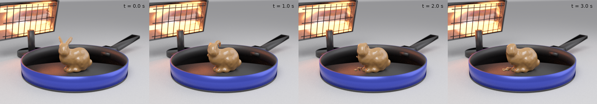

# Heatflow-MPM

Eulerian heat-and-airflow surroundings solver for thermal MPM systems.

The air in a closed box is a Stable-Fluids grid that moves and conducts heat; the material inside it is an implicit MPM body whose yield
stress and viscosity follow the temperature it receives from the grid. An electric heater (reflector, glowing rods, optional fan) stands
in the box as an obstacle and a heat source. Everything runs on the GPU with [NVIDIA Warp](https://github.com/NVIDIA/warp) and
[NVIDIA Newton](https://github.com/newton-physics/newton); a ray-traced renderer (Mitsuba 3) is included.



## What is solved

Air (grid, MAC staggered, cell size h): incompressible Euler equations with Boussinesq buoyancy,

    du/dt + (u . grad) u = -grad p / rho + g (T - T_amb) / T_amb[K] z,    div(alpha_f u + alpha_s v_s) = 0

stepped with the Stable Fluids scheme (Stam 1999; Fedkiw, Stam, Jensen 2001): semi-Lagrangian RK2 advection, buoyancy, implicit
relaxation of the face velocities toward obstacles (material particles, heater body, fan), and a pressure projection with the
mixture divergence (the material's volume fraction alpha_s and velocity v_s enter the constraint) solved by a Jacobi-preconditioned
conjugate gradient. No gravity term (pressure relative to hydrostatic), no explicit viscosity, closed walls.

Temperature (grid, cell centred): advection-diffusion with a source,

    dT/dt + u . grad T = div(kappa grad T) + q

operator split: semi-Lagrangian advection in air cells, backward-Euler diffusion solved by conjugate gradient (face conductivity =
harmonic mean; kappa blends from the air value to the material value by alpha_s), Dirichlet cells (heater rods, room walls) decoupled
symmetrically, adiabatic floor, and the heater power injected into the trough air and capped at a maximum outlet temperature.

Material (particles): Newton's implicit MPM (APIC transfers, sparse grid, viscoplastic model). Every step the material cells take the
particles' temperature, and after the grid solve each particle receives the temperature increment at its position (FLIP transfer, as in
Augmented MPM, Stomakhin et al. 2014). The melt fraction f = clamp((T - T_sol) / (T_liq - T_sol)) sets yield stress y (1 - f) and viscosity
mu_solid (1 - f) + mu_liquid f per particle. Not modelled: radiation, latent heat, density change.

## Install

    pip install -e .                      # numpy, warp-lang, trimesh, scipy, matplotlib
    pip install -e ".[render,test]"       # + mitsuba, scikit-image, pillow, imageio, shapely, mapbox-earcut, manifold3d, pytest
    # NVIDIA Newton is not on PyPI: follow https://github.com/newton-physics/newton (the MPM solver lives there)

A CUDA GPU is required (Warp kernels, Newton MPM). Tested with Python 3.11, warp-lang 1.17, newton 1.7, mitsuba 3.9.

## Run

    python scripts/run_scene.py --out data/bunny_fan  --fan 2.0 --power 400 --t-cap 120 --seconds 20   # fan heater
    python scripts/run_scene.py --out data/bunny_conv --fan 0.0 --power 400 --t-cap 120 --seconds 20   # convection only
    python scripts/analyze.py --run data/bunny_fan --every 100                                        # table + side_views.png
    python scripts/render.py  --run data/bunny_fan --times 0 2 4 6 8 10 12 14                        # contact sheet
    python scripts/render.py  --run data/bunny_fan --every 5 --video                                  # 10 fps video

Defaults: Stanford bunny 10 cm tall filled with particles at 2.5 mm spacing (about 13k), box 0.48 m with 5 mm cells (96^3), 2 ms substeps,
frames every 0.02 s, room 25 C, material 20 C at the start, heater 0.21 m from the material at 0.12 m height facing it (tilt 15 deg), rods
300 C, 400 W into the trough air capped at 120 C. Any mesh works: `--mesh path.obj --height 0.08 --yaw 30`. Cost on one RTX 5080: about
7 ms per air substep plus about 1 s per frame for the MPM, so a 20 s scene takes about 20 minutes.

Output per run: `static.npz` (box, grid, heater geometry, material constants, cell types), `meta.json` (all arguments), and
`frames/frame_NNNN.npz` with `t`, `pos`, `vel`, `temp` (f16), `melt` (f16), `grid_T` (f16, n^3) and `air_u` (f16, n^3 x 3, cell-centred).

## Use as a library

```python
from heatflow_mpm import HeatflowMPM, ThermalMaterial, Domain, Heater, mesh_particles
P = mesh_particles("assets/bunny.obj", height=0.10, spacing=2.5e-3, L=0.48)
sim = HeatflowMPM(P, ThermalMaterial(), Heater(power=400.0, t_cap=120.0, fan=2.0), Domain())
for _ in range(500):            # 1 s
    sim.substep(2e-3)
T_grid, u_air = sim.grid_T(), sim.air_velocity()          # the surroundings fields
x, T_p, f = sim.positions(), sim.temperatures(), sim.melt_fraction()   # the system
```

## Tests

    pytest -q tests

Implicit diffusion against the erfc half-space solution (error below 0.1 K), a rising plume from the heater, a fan stream heating the
material position, and a cold solid holding its shape with the heater off.

## References

- J. Stam, Stable Fluids, SIGGRAPH 1999.
- R. Fedkiw, J. Stam, H. W. Jensen, Visual Simulation of Smoke, SIGGRAPH 2001.
- A. Stomakhin, C. Schroeder, C. Jiang, L. Chai, J. Teran, A. Selle, Augmented MPM for phase-change and varied materials, SIGGRAPH 2014.
- NVIDIA Newton (SolverImplicitMPM) and NVIDIA Warp.
- Stanford bunny mesh: Stanford Computer Graphics Laboratory.

## License

MIT (see LICENSE).
